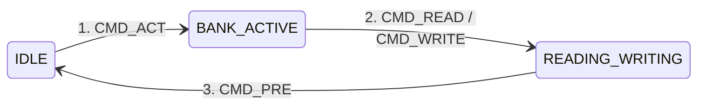
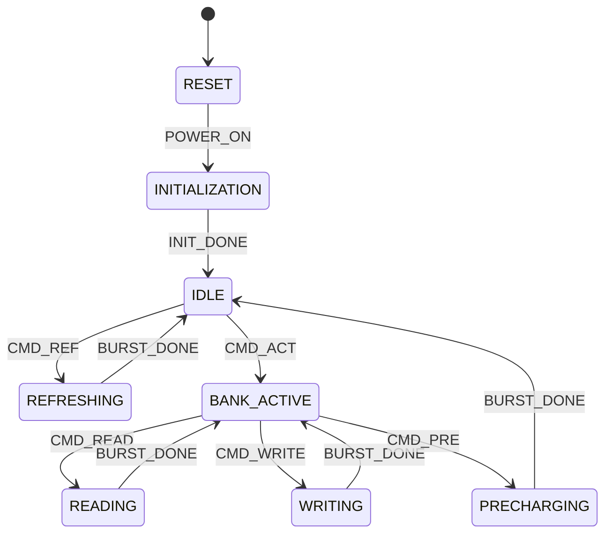

# ddram_FSM_explained
this Repo is for demonstrating how ddr finite state machine works in principle, so dont mix between real hardware DDR-controller with physical layer with this FSM concpt 

FSM data struct:

```c
enum ddr3_state_t {
    RESET,
    INITIALIZATION,
    IDLE,
    BANK_ACTIVE,
    READING,
    WRITING,
    PRECHARGING,
    REFRESHING
};

enum ddr3_event_t {
    POWER_ON,
    INIT_DONE,
    CMD_ACT,      /* ACTIVATE command */
    CMD_READ,     /* READ command */
    CMD_WRITE,    /* WRITE command */
    CMD_PRE,      /* PRECHARGE command */
    CMD_REF,      /* REFRESH command */
    BURST_DONE    /* Burst Read/Write completed */
};
```

usage:

<pre>
=== DDR3 Simulator ===
Usage:
  read &lt;row&gt; &lt;col&gt;
  write &lt;row&gt; &lt;col&gt;
  ref
  stat
======================
[init] ctrl goes to state: RESET
[Transition] <span style="color: #ff5555;">RESET</span> -&gt; <span style="color: #50fa7b;">INITIALIZATION</span>
[Transition] <span style="color: #ff5555;">INITIALIZATION</span> -&gt; <span style="color: #50fa7b;">IDLE</span>
ddr3&gt; read 0 0
[Transition] <span style="color: #ff5555;">IDLE</span> -&gt; <span style="color: #50fa7b;">BANK_ACTIVE</span>
[Transition] <span style="color: #ff5555;">BANK_ACTIVE</span> -&gt; <span style="color: #50fa7b;">READING</span>
[Transition] <span style="color: #ff5555;">READING</span> -&gt; <span style="color: #50fa7b;">BANK_ACTIVE</span>
ddr3&gt; write 1 1
[Transition] <span style="color: #ff5555;">BANK_ACTIVE</span> -&gt; <span style="color: #50fa7b;">BANK_ACTIVE</span>
[Transition] <span style="color: #ff5555;">BANK_ACTIVE</span> -&gt; <span style="color: #50fa7b;">WRITING</span>
[Transition] <span style="color: #ff5555;">WRITING</span> -&gt; <span style="color: #50fa7b;">BANK_ACTIVE</span>
ddr3&gt; ref
[Protocol Error] <span style="color: #f1fa8c;">Cannot issue REF from state BANK_ACTIVE (Bank must be IDLE)</span>
</pre>

## Simplified State Diagram 


## correct read/write operation sequence:


## FSM implm.


ref: JEDEC SOLID STATE TECHNOLOGY ASSOCIATION
JEDEC standard (JESD79-3C)
