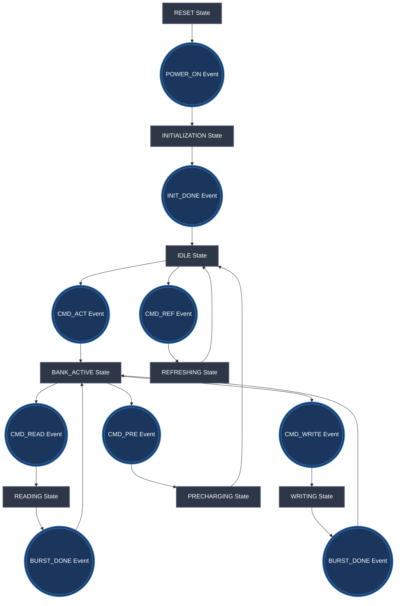

# ddram_FSM_explained
this Repo is for demonstrating how ddr finite state machine works in principle, so dont mix between real hardware DDR-controller with physical layer with this FSM concpt 

FSM data struct:

```c
enum ddr3_state_t {
    RESET,
    INITIALIZATION,
    IDLE,
    BANK_ACTIVE,
    READING,
    WRITING,
    PRECHARGING,
    REFRESHING
};

enum ddr3_event_t {
    POWER_ON,
    INIT_DONE,
    CMD_ACT,      /* ACTIVATE command */
    CMD_READ,     /* READ command */
    CMD_WRITE,    /* WRITE command */
    CMD_PRE,      /* PRECHARGE command */
    CMD_REF,      /* REFRESH command */
    BURST_DONE    /* Burst Read/Write completed */
};
```

## Simplified State Diagram 


correct read/write operation sequence:



ref: JEDEC SOLID STATE TECHNOLOGY ASSOCIATION
JEDEC standard (JESD79-3C)
